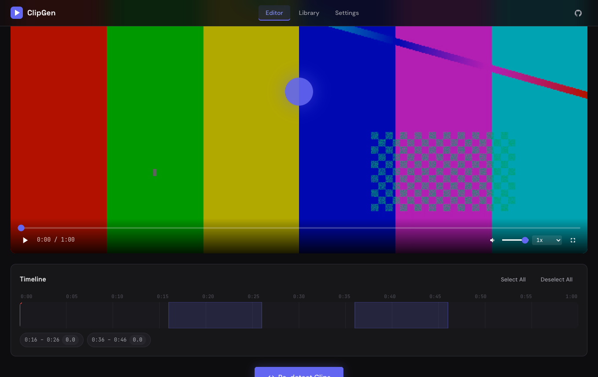
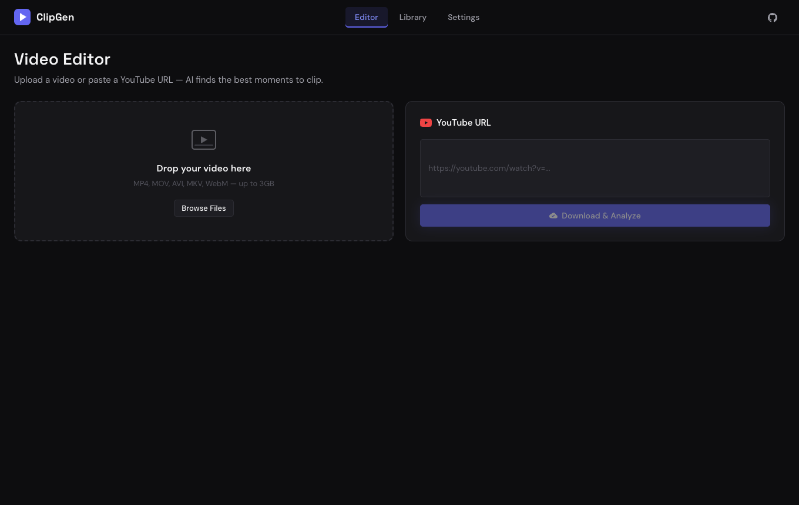
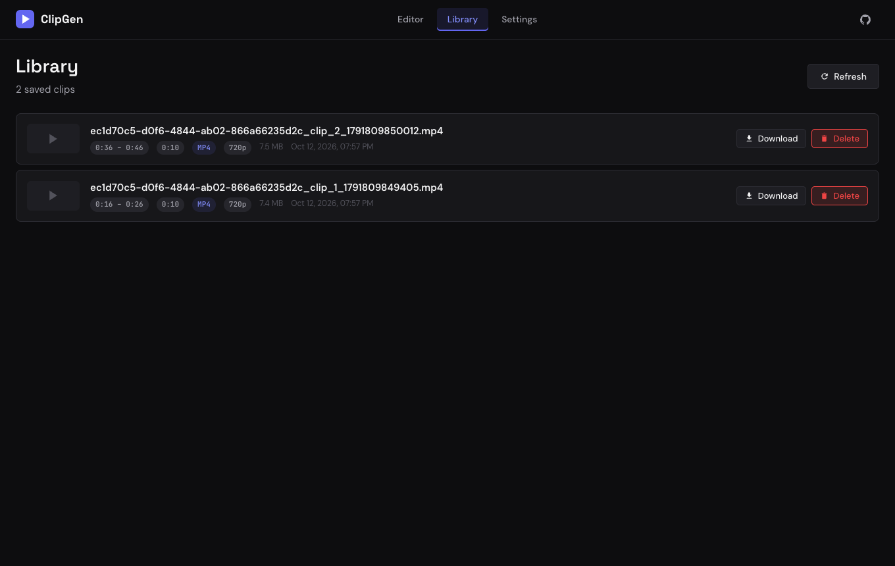

# ClipGen

Local-first AI-assisted video clipper. Upload a long video (or import a YouTube URL), let ClipGen find the most engaging moments, pick the clips you want, and export them as short-form videos (TikTok / Reels / Shorts / square) with FFmpeg.

Author: **Muhamad Septian Pamungkas**



## Features

- Upload local video (MP4, MOV, AVI, MKV, WebM; up to 3 GB) or import from YouTube via `yt-dlp`
- Automatic highlight detection: FFmpeg scene-change detection combined with per-second audio loudness, ranked relative to the video's own loudness range. No cloud AI or API keys are used; everything is local signal processing.
- Visual timeline, per-clip toggle and time editing, in-app preview
- Export presets: original / 9:16 / 1:1 / 16:9, 480p to 1080p, H.264 (MP4) or VP9 (WebM), with live SSE progress
- Clip library with download and delete

## Architecture

```
client/   React 18 + Vite SPA (Editor, Library, Settings)      :5173 (proxies /api)
server/   Express API  ->  FFmpeg / ffprobe / yt-dlp child processes   :3001
  index.js            routes: upload, youtube, stream, detect, generate (SSE), library
  services/ffmpeg.js  scene + audio analysis, clip scoring, ffmpeg arg builder
  services/youtube.js yt-dlp wrapper
test/     node:test unit + API tests (no extra test deps)
docs/     SRS / user guide (.docx), screenshots
```

Storage is plain files: `server/uploads/`, `server/output/` and `server/library.json` (all git-ignored; override with `CLIPGEN_DATA_DIR`).

## Prerequisites

- Node.js 18+ (developed on 22)
- FFmpeg (includes ffprobe): `brew install ffmpeg`
- yt-dlp (only for YouTube import): `brew install yt-dlp`

## Run

```bash
git clone https://github.com/seppam/clipgen.git && cd clipgen
npm run install:all     # root + client dependencies
npm run dev             # API on :3001 and client on :5173
```

Open http://localhost:5173. Optional: copy `.env.example` to `.env` (all values have defaults; no secrets needed).

Production-style: `npm run build && npm start` serves the built client and API together on http://localhost:3001.

## Tests

```bash
npm test
```

13 tests: ffmpeg command building, clip scoring (non-overlap, bounds, fallbacks), audio-level parsing, and API tests including an end-to-end flow (generates a 40 s sample with ffmpeg, then upload -> detect -> generate -> download -> delete). The end-to-end test is skipped automatically if ffmpeg is not installed.

## API

| Method | Endpoint | Description |
|--------|----------|-------------|
| GET | `/api/health` | Health check |
| POST | `/api/upload` | Upload a video (multipart field `video`) |
| POST | `/api/youtube` | Import a YouTube URL (SSE progress) |
| GET | `/api/stream/:id` | Range-enabled video streaming |
| POST | `/api/detect` | Detect highlight clips `{ videoId, minDuration, maxDuration }` |
| POST | `/api/generate` | Cut clips `{ videoId, clips[], format, quality, aspect }` (SSE progress) |
| GET | `/api/download/:clipId` | Download a generated clip |
| GET / DELETE | `/api/library`, `/api/library/:clipId` | List / delete saved clips |

## Screenshots

| Home | Library |
|---|---|
|  |  |

## Limits and notes

- Local-first and single-user: no authentication, CORS is limited to localhost:5173. Do not expose it to the internet as is.
- Detection is heuristic (scene changes + loudness), not semantic understanding of content. Quality is best on speech/music-driven videos.
- YouTube import is for content you own or have permission to use. Downloading and re-cutting third-party videos may violate YouTube's Terms of Service and copyright law; you are responsible for how you use it.
- Keyboard shortcuts in the player: Space, Left/Right (seek 5 s), M, F.
- More detail in [SPEC.md](SPEC.md) and [docs/ClipGen_SRS_UserGuide_v1.0.0.docx](docs/ClipGen_SRS_UserGuide_v1.0.0.docx).

## License

MIT
